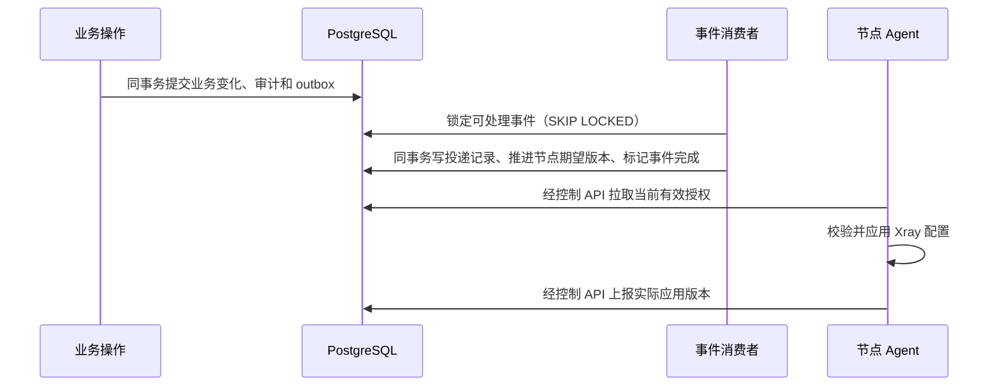

# 节点组、套餐授权与业务事件

当前控制端支持节点组、下单时的套餐授权快照，以及事务发件箱消费。管理员在“权限管理”维护节点组和套餐关联，节点继续主动拉取配置。控制端完成事件投递与 Xray 实际应用是两个独立状态。

## 配置路径

1. 在“节点管理”创建节点并配置入站。将入站授权模式设为“按套餐节点组”，用户列表必须为空。
2. 在“权限管理”创建节点组，选择其成员节点并启用。一个节点可以属于多个组，每个组最多 100 个成员。
3. 为套餐选择节点组。保存携带当前套餐授权版本；并发修改后旧版本返回 409，需重新读取。
4. 用户创建新订单时保存套餐节点组快照；支付成功时将订单快照复制到该权益周期。只有当前生效、未撤销、未到期且尚有额度的周期可授权。
5. 节点下次拉取时按有效权益、已购买组、组启用状态和当前成员关系生成用户配置。订阅还要求管理员发布连接地址、节点完成应用并保持有效心跳。

套餐关联变化只影响之后创建的新订单。已经下单但尚未支付的订单也保留原组快照，支付时不读取新的套餐配置。例如订单下单时包含 A 组，套餐后来改成 B 组，该订单支付后仍获得 A 组。

节点组的成员和启用状态属于运行时配置，会影响已经购买该组的权益。停用 A 组会使依靠 A 组的用户失去相关节点；重新启用会恢复符合条件的授权。把某节点移出 A 组后，该节点不再通过该组授权用户。组不提供删除操作，以保留订单、权益和事件的历史引用；不再使用时停用或清空成员。

## 兼容模式与撤销

`access_mode` 省略或为空时保持原来的 `manual` 模式：只为逐用户名单中、且当前有有效权益的用户授权。`plan` 模式只按套餐组授权，不同时叠加手工名单。修改组不会取消独立手工授权；如需改为统一套餐控制，应将对应入站切换为套餐模式。

迁移 v6 不为旧订单补造节点组快照，不自动把旧入站改为套餐模式。旧订单和旧权益继续使用原手工授权，或由运营按后续明确的迁移流程处理。

`POST /api/v1/admin/entitlements/{id}/revoke` 撤销整个权益周期，在手工和套餐模式下均不再授权。重复撤销返回成功，不重复生成撤销事件。撤销不退款、不改变已购买周期的起止时间，也不自动提前后续续费周期；当前没有恢复已撤销周期的接口。撤销后的合法迟到流量仍按历史授权计入原周期。

一个入站目前最多下发 100 个有效用户。套餐模式超过这个数量时配置读取报错，不截断用户列表或虚报已应用；应先按实际规模划分节点和入站。配置替换仍会中断节点的所有现有连接，失联由最长 60 秒授权租约限制继续运行。

## 事件从提交到应用

控制端正常启动时自动运行消费者，约每秒扫描权益时间变化并最多处理 50 个可用事件。单独运行管理员提权/降权 CLI 不启动消费者。多个控制端可以并发消费，事件行锁与 `SKIP LOCKED` 避免互相等待同一事件。

| 事件 | 节点范围与作用 |
| --- | --- |
| entitlement.granted | 支付事务生成；通知曾为该用户建立凭据的节点，以及购买组当前成员节点 |
| entitlement.activated | 周期开始且当前有效时生成；重复时间扫描不会生成第二份同类事件 |
| entitlement.expired | 周期结束后生成；重复扫描按同类事件和周期去重 |
| entitlement.revoked | 管理员撤销时原子生成，通知相关节点重新协调 |
| node_group.changed | 通知该组修改前后成员的并集，覆盖被移出和新加入的节点 |
| plan.access_changed | 记录套餐授权变更；只影响新订单，不推进旧权益节点版本 |

每个事件与节点最多有一条 `outbox_deliveries` 记录。该记录、节点期望版本推进和事件 `processed_at` 在同一个事务提交；失败回滚后重试，不会重复提交同一事件的节点效果。不同事件可以分别推进版本，即使最终授权内容相同，Agent 也会确认最新版本；内核内容不变时不会为版本提示而重启 Xray。

授权始终从当前数据库状态计算。事件只提示节点重新协调，不携带可直接信任的完整授权名单。即使事件延迟或失败，节点拉取与订阅筛选仍会检查当前组状态、当前权益与撤销状态，不能以事件未消费为由继续发出已撤销授权。

## 重试和排查

消费失败后保存脱敏错误码和失败次数，按指数退避安排下一次处理，退避上限 300 秒；达到 5 次失败后进入死信状态，不阻塞其他事件。错误类别包括 `invalid_payload`、`unsupported_kind` 和 `delivery_failed`，不向后台输出数据库凭据或 SQL 参数。

“权限管理”显示最近 100 个事件。`processed_at` 表示控制端已完成该事件的投递处理，不表示节点已经读取，更不表示内核已应用。应在“节点管理”继续查看已读取版本、已应用版本、失败原因和最近心跳。

修复问题后，可重试失败且未完成的事件。重试会清除当前错误、失败计数和死信标记，并立即重新入队；已完成事件及尚未失败的普通待处理事件返回 409。重试请求写入管理员审计。本轮没有逐次失败历史表、外部消息队列或主动推送通道。

已新增共享限流、邮箱验证与找回密码、后台分权和账号邮件投递，详见 [security-and-mail.md](security-and-mail.md)。下一阶段仍需真实支付沙箱和核对、可信代理策略、故障注入、备份恢复及生产规模验证。当前能力和验证结果见 [delivery.md](delivery.md) 与 [verification.md](verification.md)。
