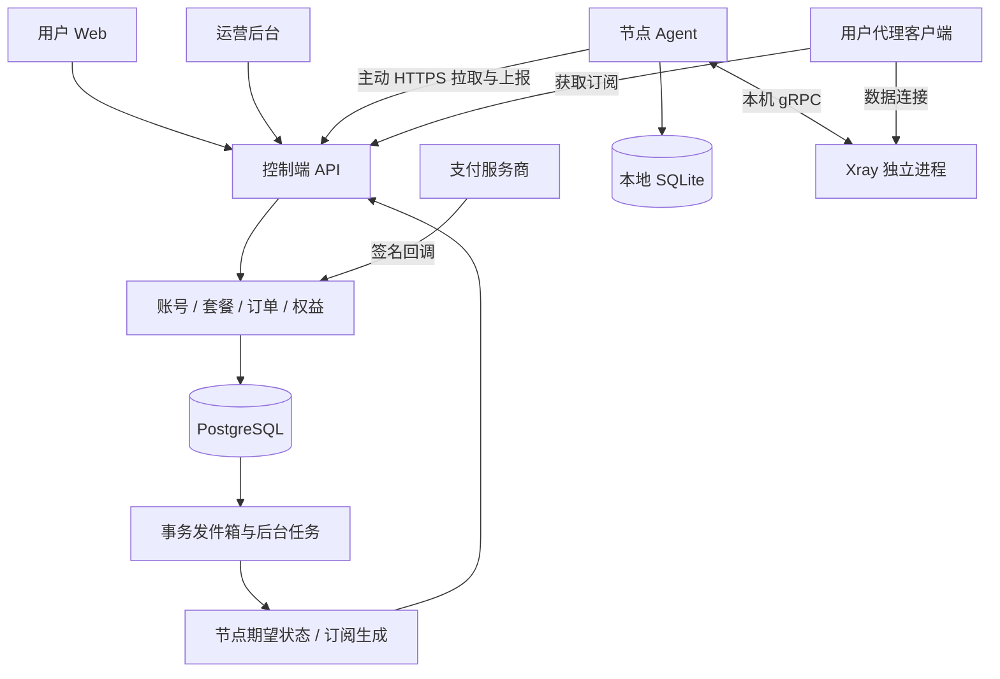

**xui 完整平台开发方案｜讨论稿｜2026-10-26**

产品范围已经按用户最新要求确定：自建用户端、运营后台、套餐与订单支付、订阅分发、流量配额，以及运行在服务器上的节点 Agent。Air-Universe 作为节点 Agent 的功能参考；完整平台采用独立产品设计和独立实现。

调研基线：`crossfw/Air-Universe` 默认分支 `master`，提交 `010cbc6735c5a6b19c72cb7c06e422a3a533a3e4`，提交日期为 2022-05-13。本次检查了文档、Go 源码、配置、依赖和发布流程，没有运行其测试、连接真实面板或验证生产效果。本文中的接口、性能、工期和验收项均为待开发方案，不是已经具备的功能。

**1. 参考项目结论，以及我们的产品定位**

Air-Universe 的核心流程是：从 V2Board、SSPanel 或 django-sspanel 获取节点和用户信息，通过 Xray API 管理入站和用户，向面板回报流量和部分运行状态。完整平台需要在它覆盖的节点端之外，自建账号、商品、支付、授权、订阅、运营及数据管理能力。

| 参考项目能力或实现 | 静态调研结论 | 我们的设计方向 |
| --- | --- | --- |
| 面板适配 | 有三种面板的适配代码 | 首版优先对接自建控制端，第三方面板作为后续迁移适配 |
| 协议 | VMess、Trojan、Shadowsocks；VLESS 有部分用户操作代码，自动创建入站不支持 | 用版本化能力矩阵逐项验证，不笼统宣称全部支持 |
| 多节点 | 一个进程处理多个节点 ID 和入站 | 采用具名绑定及独立状态，避免按数组下标关联 |
| 用户同步 | 拉取、比较、增删用户 | 改为可重试的状态协调，只有成功操作才能推进已应用版本 |
| 流量 | 查询时清零，数据保留在内存，上报失败在同一流程中循环重试 | 采用累计计数、持久化发件箱、独立投递和服务端去重 |
| 在线统计 | 读取、解析并清空访问日志，主要在 SSPanel 路径使用 | 优先使用内核统计 API，日志兼容使用偏移跟随并处理轮转 |
| TLS | 读取外部证书；自动生成分支使用内核证书生成工具 | 明确外部可信证书、自签证书与 ACME 的区别 |
| 限速与设备限制 | 文档有手动配置、实验或不支持的项目 | 能力必须经过真实测试，未实现不能在界面上显示已生效 |
| 工具链 | go.mod 为 Go 1.18、xray-core 1.5.4；发布工作流设置 Go 1.16 | 重新选定受支持版本，保持开发、CI 和发布一致 |

源码中还可以看到：流量上报重试会阻塞该节点的后续同步；部分用户操作失败后仍可能推进比较快照，造成漏重试风险；入站配置变更使用先删除再新增的方式。这些是具体实现路径分析，不代表本次已经复现线上故障。

我们的目标产品是“可独立运营的订阅服务管理平台”。首版面向一个运营方管理多个节点服务器，以预付套餐、固定有效期和周期流量额度为主要业务模型。流量作为套餐权益消耗，不按原始字节直接生成后付费账单。

**2. 首版边界和差异化**

| 优先级 | 功能范围 |
| --- | --- |
| P0：完整业务闭环 | 注册登录、找回密码、套餐展示、下单、支付宝/微信/易支付接入、支付回调、权益开通、节点分组、订阅生成、Agent 同步、流量计量、到期与配额处理、用户及订单管理、审计、备份恢复 |
| P1：运营与稳定性 | 公告、工单、续费体验、节点健康告警、可信证书到期提醒、批量运营、订阅访问诊断、统计报表、升级回退、真实环境长期运行验证 |
| P2：业务扩展 | 优惠券、邀请返佣、余额钱包、复杂退款、套餐即时升降级和差价、更多支付商、第三方面板迁移、更多协议、多租户、跨节点硬设备限制 |

当前按用户要求支持支付宝、微信和易支付三类接口，使用一个币种、明确的各渠道商户身份和一个有效订阅周期规则。用户可以购买和续费；首版变更套餐在下个周期生效，避免同时引入按天折算、余额抵扣和多份重叠权益。

首发协议调整为 VLESS TCP+TLS 和 Trojan TCP+TLS。2026-10-26 的官方 Xray 26.10.21 实测确认 VLESS/VMess TCP 动态用户与非重置统计能力，并发现 VMess 已被内核标记弃用，因此将 VMess 保留为后续兼容项。2026-10-27 已进一步完成平台 VLESS/Trojan TCP+TLS 真实连接、授权与失联停机验证；已进一步完成持久化流量计量，以及官方 Xray/Mihomo 指定版本的订阅连接验证；实际交付边界以仓库 docs/delivery.md 为准。REALITY、Shadowsocks AEAD/2022 等按需求进入后续版本；Shadowsocks 单端口多用户必须先验证实际内核、密码格式、加密方法和客户端组合。详细依据见仓库 docs/xray-capability-report.md。

差异化重点是：支付与权益的一致性、可核对的流量账本、节点变更记录、解释清楚的故障状态、现代化用户和运营界面。项目品牌、页面布局、文案、配置结构、接口、领域模型和实现均独立设计。

**3. 用户端和运营后台的页面及操作**

| 用户端页面 | 主要操作与展示 |
| --- | --- |
| 注册、登录、找回密码 | 邮箱验证、登录会话、重置凭据、异常尝试限制 |
| 用户概览 | 当前套餐、有效期、本周期额度、已用流量、最近统计时间、服务公告 |
| 套餐商店 | 价格、周期、额度、节点分组、适用范围，展示实际可提供的限制能力 |
| 订单与支付 | 创建订单、跳转支付、查看权威支付结果、继续未完成支付、历史订单 |
| 我的订阅 | 复制或导入订阅、选择客户端格式、查看可用节点、重置订阅令牌 |
| 流量与服务状态 | 上传/下载、周期消耗、节点维护状态、统计延迟说明 |
| 账号设置 | 修改密码、退出其他会话、订阅令牌重置、通知设置 |
| 公告和工单（P1） | 阅读公告、提交问题、查看回复 |

| 运营后台页面 | 主要操作与展示 |
| --- | --- |
| 概览 | 订单与实收、有效订阅、流量、节点在线状态、待处理异常 |
| 用户 | 查询、禁用、重置会话、查看权益和流量，人工调整必须记录原因 |
| 套餐 | 创建、上架、价格、额度、周期、节点分组；历史订单保留购买时快照 |
| 订单和支付 | 订单状态、渠道流水、回调记录、支付核对、重复付款、退款处理 |
| 节点与分组 | 注册 Agent、协议、地址、证书状态、分组授权、维护、配置版本 |
| 订阅和权益 | 当前及未来周期、启用/暂停原因、人工调整记录 |
| 流量与对账 | 原始计数、已入账批次、待处理、异常事件、聚合统计 |
| 运维诊断 | 面板/Agent 版本、最后心跳、期望与已应用版本、同步失败、队列积压 |
| 系统与权限 | 角色、权限、支付配置、邮件配置、备份状态、审计日志 |

首版角色为用户、客服、运维、财务和超级管理员。客服不能修改支付密钥或节点凭据，运维不能修改财务记录，财务不能获取用户代理凭据。敏感操作要求再次确认身份并留下不可由普通后台操作删除的审计记录。

**4. 总体架构与技术选型**

采用“模块化控制端 + Web 前端 + 节点 Agent”。控制端首版保持一个可部署服务，通过清晰模块边界组织代码，降低跨服务事务和运维成本。



| 部分 | 建议选型 | 作用 |
| --- | --- | --- |
| 控制端 | Go，受支持的稳定版并精确锁定 | 业务 API、订单、授权、节点协调、任务 |
| 业务数据库 | PostgreSQL，选定受支持大版本 | 事务、唯一约束、权益、账本、审计、任务持久化 |
| 数据访问 | pgx + sqlc + SQL 迁移工具 | 显式 SQL，关键事务可审查 |
| Web | Vue 3 + TypeScript + Vite + Naive UI | 用户端、运营后台；共享组件与类型 |
| Agent | Go + SQLite | 配置协调、进程监督、游标及本地持久化队列 |
| 内核 | 官方 Xray 稳定版，独立进程 | 代理协议和数据流量，API/版本逐项验证 |
| 任务 | PostgreSQL 事务发件箱 + 后台 Worker | 支付后开通、邮件、节点状态更新、重试 |
| 接口 | 版本化 JSON API + OpenAPI | 生成前端类型，保持控制端与 Agent 契约一致 |
| 运维 | Docker Compose、systemd、结构化日志和 Prometheus | 单机部署起步，后续再按实际负载拆分 |

Redis 可在实际需要缓存、共享限流或更大任务吞吐时引入；首版核心正确性不依赖易失缓存。控制端承载管理流量，用户的数据连接直接进入节点；控制端带宽不能按节点代理吞吐估算。

首版部署可以是一个 Web/API 服务、一个后台 Worker、一个 PostgreSQL、一个 HTTPS 入口。每台节点部署 Agent 和其监督的 Xray。平台数据库和 Agent 的 SQLite 都必须使用持久卷，不能依赖容器临时文件系统。

**5. 四条核心业务流程**

**购买与开通。** 用户选择套餐后，服务端创建价格、币种、周期、额度和节点组的购买快照，并生成订单；支付渠道由服务端创建支付单。浏览器返回成功页面只展示“正在确认”，不能作为开通依据。

支付回调先验签，再核对商户、订单、金额、币种及交易状态。使用渠道事件/交易唯一键去重，并在同一数据库事务中完成支付记录、订单状态更新、权益发放及待执行事件写入。事务提交后才向渠道确认成功。重复通知、回调乱序、请求超时和用户刷新都不能重复开通。定时任务通过支付商权威查询接口补查遗漏通知。

支付尝试与订单分开存储。一个订单只允许成功履约一次；对多次付款、已过期订单的迟到付款、金额不符和退款中的订单进入明确的处理流程，不能简单丢弃或自动覆盖。

**订阅分发。** 用户拥有有效权益后，平台根据套餐节点组、节点状态、协议能力和用户凭据生成客户端配置。首版提供一种通用 URI/Base64 订阅和一种明确版本的 Clash Meta 兼容格式，均根据公开规范独立实现并用真实客户端验证。

订阅 URL 使用独立高熵令牌，服务端保存其摘要；用户重置后旧链接失效。订阅令牌与网页登录会话、Agent 身份分离。返回的配置不包含后台地址、支付信息和节点管理密钥。订阅泄漏与代理凭据泄漏的处置不同：重置链接不自动等同撤销客户端已经取得的代理凭据。

**节点授权。** 节点安装后通过一次性、限时注册令牌注册，换取独立、可轮换且限定节点权限的身份凭据。Agent 只主动连接控制端，获取分配给自己的节点和用户期望状态。其管理 API 保持本机访问，浏览器不直接调用 Xray。

每次期望状态有版本和摘要，Agent 校验后生成变更计划、调用内核、核验结果并报告已应用版本。单个用户操作失败不把整批记为成功；控制端可以看到期望版本和已应用版本的差异。内核重启后重建状态，不只相信旧内存。

**流量与配额。** Agent 获取累计流量，在本地事务中保存增量与游标后异步上报。控制端去重入账、更新权益周期内的使用量，达到阈值或有效期结束后生成撤销授权的新版本。用户端和后台能查看统计时间与节点是否已经执行撤销。

**6. 数据模型与状态机**

| 领域 | 主要实体与约束 |
| --- | --- |
| 账号 | users、sessions、verification_tokens；邮箱唯一，验证令牌摘要存储且过期可撤销 |
| 权限 | roles、permissions、role_memberships；用户端与后台写权限分开 |
| 商品 | plans、plan_versions、node_groups；订单引用购买快照，不被后续改价改变 |
| 订单 | orders、order_items、payment_attempts；订单号唯一，金额为最小货币单位整数 |
| 支付 | payment_events、payment_transactions、refunds；渠道交易及事件有唯一约束 |
| 授权 | subscriptions、entitlement_periods、entitlement_grants；发放来源唯一，生效和到期明确 |
| 节点 | nodes、node_bindings、node_group_memberships、agent_identities、core_instances |
| 凭据与订阅 | access_credentials、subscription_tokens；查询令牌存摘要，需要下发的凭据受控加密保存 |
| 使用量 | usage_batches、usage_entries、usage_aggregates；批次唯一、内容摘要固定，可回溯原始入账 |
| 运维 | desired_revisions、applied_revisions、node_events、outbox_events、audit_events |

订单生命周期与支付、履约、退款状态分开表达。付款成功和权益发放在同一事务中处理；退款通过追加退款记录和权益调整完成，不删除原交易或篡改历史实收。

权益周期包含开始时间、结束时间、额度、使用口径和购买来源。首版同一用户在同一时刻只持有一套生效套餐权益，续费追加未来周期；套餐调整在下周期生效。人工赠送、延期或扣减通过有来源及原因的调整记录完成。

首版计量采用上传加下载的原始字节，额度用明确的 GiB 单位展示，1 GiB = 1024³ 字节。复杂节点倍率后续通过版本化规则加入，不使用浮点金额，也不在 Agent 和控制端重复应用倍率。

时间以 UTC 存储，界面按用户时区展示；周期边界采用明确的开始包含、结束不包含规则。晚到流量归属历史权益周期，不能因为已经续费就全部算进新周期。节点在周期切换前后采集，测试时明确采样与时钟误差，不承诺不存在的逐包时间精度。

**7. 两个最重要的一致性设计**

支付正确性的核心是不依赖页面和消息只到达一次。支付回调可以重复，Worker 可以重启，权益只能发放一次。唯一约束、状态转换条件和同一数据库事务是正确性基础；邮件、通知和节点同步通过事务发件箱重试，不放在支付数据库事务里等待网络完成。

流量处理采用以下步骤：

1. Agent 从内核读取不清零的累计上传/下载计数，确保没有另一个程序同时重置这些计数。
2. 按内核实例、节点绑定、用户凭据和方向计算增量，避免重启或相同用户 ID 引起串账。
3. 在同一 SQLite 事务中写入待投递数据并推进游标；失败不推进。已经发出的批次 ID 和内容保持不变。
4. Agent 通过 `POST /agent/v1/usage-batches` 上传批次；控制端验证该节点有权提交这些绑定和用户的数据。
5. PostgreSQL 在一个事务中插入批次、写入明细、更新汇总和配额状态、创建后续节点变更事件；提交后返回确认。
6. 相同节点和批次 ID、相同摘要的重投返回已有结果；相同 ID 但内容不同拒绝处理，避免异常覆盖。
7. Agent 收到确认后标记批次已完成。应答丢失时可以安全重投，Worker 与节点授权同步均独立重试。

由于控制端是我们自己开发，可以在接收端实现幂等，因此实现“至少一次投递、去重后一次入账”。这与“任何故障都零丢失”是不同目标：内核异常退出仍可能丢失最后采样后的内存计数；需要缩短采样窗口、计划重启前采集、持久化内核实例身份，并记录计量不确定事件。

Agent 队列持久化、未发送记录按规则聚合；发出后不改内容。按活跃用户数、周期和可容忍断网时间计算磁盘预算。队列满或磁盘异常必须暴露告警，不能静默丢数据或推进未持久化的游标。

后续如果兼容不支持幂等的旧面板，需要单独说明应答丢失后的重复计费风险，不能把自建平台的去重保证直接套给第三方面板。

**8. 配额、到期和“限制已生效”的边界**

套餐有效期由控制端权威判定，Agent 同时获得必要的本地到期信息，短时断网不能让已经知道的到期规则失效。新节点没有有效状态时不创建未授权用户；已有节点在短时控制端故障时使用最后有效状态，并执行已知到期规则。断网后的最长容忍时间和授权租约是必须明确的产品策略。

流量配额是分布式限制：采样、上传和撤销下发之间有延迟，多个节点同时使用也会产生超额窗口。超额量取决于流量速率与延迟；没有经过验证的速率上界，就不能承诺固定字节数的最大超额。

特别需要在第一阶段验证：Xray 删除用户是否只影响新连接，如何处理已经建立的连接。撤销凭据不自动等同所有现有连接立即终止。若首发内核没有可靠的单用户断流能力，必须明确阶段性软配额语义；对严格硬额度的商业承诺，应以更换/扩展内核并通过验收为上线前置，不能靠界面显示“已停用”代替执行。

用户数、连接数、IP 数和设备数分别展示。NAT、IPv6 和多客户端会使 IP 数与设备数不同。跨节点硬设备限制需要集中会话协调，首版不作为已完成能力售卖。

用户限速也必须有真实执行机制。给用户设置一个 level 或显示一个 Mbps 字段，不证明限速有效。节点总带宽整形与加密流量中的每用户限速分别验证；内核不支持时，界面必须如实显示能力限制。

入站配置更新先校验、记录旧版本、生成操作日志，再按实际能力热更新或安排替换。相同端口替换可能中断连接；gRPC 多操作不是原子事务，回滚采用补偿操作并展示实际结果，不宣传所有变更零中断。

**9. 接口、代码组织和部署约定**

建议的 API 分组：

- `/api/v1/auth/*`：注册、验证、登录、找回密码、会话。
- `/api/v1/me/*`：个人资料、套餐权益、用量、订阅令牌。
- `/api/v1/plans`、`/api/v1/orders/*`：商品和订单。
- `/api/v1/payments/notify/{provider}`：渠道签名回调，使用独立认证规则。
- `/api/v1/admin/*`：运营资源和后台操作，逐项权限校验。
- `/agent/v1/enroll`、`/agent/v1/desired-state`、`/agent/v1/applied-state`、`/agent/v1/usage-batches`、`/agent/v1/heartbeat`：节点专用接口。
- `/sub/{token}`：客户端读取订阅，具备独立限流、缓存与撤销规则。

Agent 采用主动拉取或长轮询，状态有版本；事件通知只用于减少延迟，不能成为唯一状态来源。业务状态以数据库为准，通知丢失可以靠重新拉取恢复。

建议代码组织：

```text
cmd/control/              控制端入口
cmd/worker/               后台任务入口
cmd/agent/                节点 Agent 入口
internal/accounts/        账号、验证、会话
internal/catalog/         套餐、版本、节点组
internal/orders/          订单及购买快照
internal/payments/        渠道适配、回调、核对、退款
internal/entitlements/    权益周期、发放和调整
internal/subscriptions/   订阅格式生成与令牌
internal/nodes/           注册、期望状态、执行结果
internal/usage/           幂等入账、汇总、配额
internal/audit/           审计
internal/tasks/           事务发件箱及 Worker
agent/                    本地协调、内核适配、SQLite、采集和投递
web/user/                 用户 Web
web/admin/                运营后台
web/shared/               组件、API 类型、校验
api/                      OpenAPI 与契约
migrations/               数据库迁移
tests/                    契约、集成、支付和故障用例
deploy/                   Docker、systemd、发布配置
docs/                     产品、接口和运维文档
```

用户会话使用安全 Cookie、明确的 CSRF 防护和受控跨域策略；密码使用成熟的密码散列算法。节点身份和订阅令牌单独授权、轮换和撤销。需要下发的代理凭据受控加密保存；仅用于验证的令牌尽量只存摘要。

日志记录订单号、节点 ID、阶段和错误类别，隐藏密钥、订阅令牌、密码、完整认证 URL 及不必要的个人信息。指标不把每个用户 ID 当标签，避免高基数失控。后台高权限账号提供二次验证，支付配置变更及人工权益调整记录审计。

首版 TLS 使用外部有效证书并验证有效期、证书与私钥匹配，提供到期提醒和重载。自动 ACME 后续单列域名验证、续期和凭据管理，不把自签证书当成公共可信证书。

控制端数据库每日备份，设定恢复演练和保留策略。发布前备份，迁移有版本，不假设每种数据库变更都可自动回退。支付、使用量与权益记录采用追加和调整，避免后台直接删除账本数据。

**10. 独立实现和许可证边界**

Air-Universe 标示 GPLv3 并附 GPLv3 许可证。直接复制、改名、改写变量或搬运模块，不能因此声称属于独立实现或已排除许可证义务。

本项目从业务场景重新编写需求，按官方公开协议和经授权测试实例设计接口；独立编写源码、算法、配置、页面、文案、脚本、测试数据和文档，不 fork 或导入 Air-Universe 的实现。兼容功能不要求复用其代码组织。

成熟第三方库可以依法使用，记录实际锁定版本、来源、许可证和必要声明。调研时 Xray 主线许可证为 MPL 2.0；最终以采用版本和依赖清单为准。内核作为独立进程是架构选择，不单凭进程边界作许可证结论。自有代码的许可证在发布前确定。

本次调研接触了参考源码，因此不能把后续工作宣传为严格“净室开发”。如果商业合同要求严格净室，需要另行安排只接收行为规格且没有接触原实现的开发人员。

**11. 开发阶段、人员和具体交付物**

以下估算基于两名熟悉 Go 的后端、一名前端，以及兼职测试/运维。以验收通过推进阶段，第三方商户开通及未知内核能力可能改变进度。

| 阶段 | 时间 | 主要交付和退出条件 |
| --- | --- | --- |
| 产品与技术验证 | 第 1–2 周 | 用户端/后台原型、业务规则、订单权益状态机、数据模型、API 契约；锁定 Xray/客户端版本；完成热更新、流量、用户撤销与现有连接的 PoC；选择一个可用支付商 |
| 平台骨架 | 第 3–4 周 | 账号、会话、后台权限、套餐、购买快照、订单、模拟支付流程、数据库迁移、部署骨架和 CI；可完整演示但不宣称真实支付上线 |
| 支付与订阅 | 第 5–6 周 | 三类支付接口与至少一个渠道的商户沙箱验收、验签去重、金额核对、权益发放、续费、订阅令牌、两类客户端配置；完成重复/乱序回调测试 |
| 节点完整链路 | 第 7–8 周 | Agent 注册、两种首发协议、真实客户端连接、多节点授权、累计计量、持久化上报、服务端去重；完成购买到实际使用的沙箱全链路 |
| 运营与故障恢复 | 第 9–10 周 | 到期/配额、节点维护、健康告警、人工调整、退款流程、订单/流量核对、用户诊断和权限验收 |
| 测试与试运行 | 第 11–12 周 | 真实客户端矩阵、支付商测试、压测、72 小时运行、故障注入、备份恢复、升级演练、运维文档；进入受控测试版 |
| 稳定版本 | 第 13–16 周 | 修复试运行问题、完善部署、支付及客户端差异；达到上线门槛后发布 v1.0 |

两名后端可以分别负责交易/授权和节点/计量，前端围绕同一套 API 契约并行。账号、订单和 API 必须先稳定到可集成程度，不能把所有联调留在最后两周。

一名开发者同时覆盖产品、前后端、支付、Agent、测试和运维，建议至少按 4–6 个月规划，并为生产稳定性继续留出时间。完整平台的开发量明显高于节点 Agent 子系统。上述是规划估算，不是固定交付承诺。

每阶段至少交付代码、迁移、API 文档、可复现运行说明和验收结果。第一阶段的具体任务单：

1. 画出用户购买、支付确认、权益发放、订阅获取、节点执行、用量扣减、到期停用的流程。
2. 确定周期、续费生效、套餐变更、使用量单位、退款和断网授权策略。
3. 定义数据库及唯一约束，特别是订单履约、支付事件和流量批次。
4. 完成用户端和后台关键页面原型，按真实能力设计套餐字段。
5. 独立验证 Xray 用户更新、计量及撤销语义，明确软/硬额度门槛。
6. 用模拟服务冻结 API 契约，建立控制端、Agent 和 Web 骨架。
7. 配置开发/测试部署及 CI，先跑一个最小端到端场景。

**12. 验收标准和上线门槛**

| 范围 | 必须验证的行为 |
| --- | --- |
| 支付 | 重复和并发回调不重复开通；金额/币种不符不发权益；迟到付款、漏通知和重复付款可核对 |
| 事务 | 在订单更新、权益发放和事件写入中途终止进程，恢复后状态仍一致 |
| 账号与权限 | 用户不能访问他人订单/订阅；客服、运维、财务权限隔离；令牌撤销有效 |
| 订阅 | 两类真实客户端能够导入和连接；令牌重置后旧订阅 URL 失效；代理凭据撤销另有验证 |
| 多节点 | 相同用户/绑定标识不会串账，不向无权节点下发凭据 |
| 流量 | 相同批次重投只入账一次，内容冲突拒绝；晚到批次归属正确周期 |
| Agent | 重启恢复队列、游标和状态；部分操作失败不会被误记成功 |
| 内核 | 异常退出可重建配置，计数新实例不会产生负数/串账，缺失窗口可见 |
| 限制 | 到期、禁用、额度耗尽分别测新连接和现有连接，不用 UI 状态代替实际行为 |
| 断网 | 明确授权租约与过期策略，节点在约定窗口内按规则运行 |
| 存储 | 数据库或磁盘异常有告警，没有静默丢批次或推进未持久化游标 |
| 运维 | 全新机器部署、备份恢复、升级失败回退、证书变更和到期提醒有演练记录 |

候选压测规模：控制端 1 万账号、100 个节点；单节点 1 万配置用户、5 个绑定。它们是配置规模，不等同真实并发连接承诺。代理吞吐需在指定 CPU、带宽、协议、客户端和加密配置下单独压测。

建议的初始目标：健康链路中授权变更可在 45 秒内传播并执行；流量重复投递不会重复入账；支付重复通知不会重复发权益；稳定版本通过至少 72 小时持续运行。统计时间、额外延迟、实际断流能力和故障恢复边界要有测试报告，不能直接把目标写成产品保证。

CI 包含 Go 测试、race 检查、静态检查、前端类型/构建检查、PostgreSQL 集成测试、真实 Xray 及客户端测试、支付模拟故障、依赖和发布检查。支付测试使用沙箱及独立编写的事件样本，后续再接入商户许可的正式验证。

开始真实上线前需要提供：平台域名及 HTTPS 配置、可合法开通并适用于业务的支付商户与目标币种、邮件服务、节点测试机和部署区域、首批用户/流量规模及退款规则。这些信息不阻止先做模型、原型和沙箱，但商户与凭据不能由开发者虚构或放在聊天中传递。

现有云环境只是已验证的基础开发环境。实际开始本项目时，需要继续锁定和验证 Go、PostgreSQL、Xray、集成测试依赖及上述服务连接；不能把之前的基础检查当作完整平台已经就绪。

**13. 调研依据和本轮产出**

- [Air-Universe README（固定调研提交）](https://github.com/crossfw/Air-Universe/blob/010cbc6735c5a6b19c72cb7c06e422a3a533a3e4/README.md)
- [许可证](https://github.com/crossfw/Air-Universe/blob/010cbc6735c5a6b19c72cb7c06e422a3a533a3e4/LICENSE)
- [配置及功能文档](https://github.com/crossfw/Air-Universe/blob/010cbc6735c5a6b19c72cb7c06e422a3a533a3e4/docs/Doc_cn.md)
- [同步流程](https://github.com/crossfw/Air-Universe/blob/010cbc6735c5a6b19c72cb7c06e422a3a533a3e4/cmd/Air-Universe/main.go)
- [流量查询](https://github.com/crossfw/Air-Universe/blob/010cbc6735c5a6b19c72cb7c06e422a3a533a3e4/pkg/XrayAPI/traffic.go)
- [入站及证书处理](https://github.com/crossfw/Air-Universe/blob/010cbc6735c5a6b19c72cb7c06e422a3a533a3e4/pkg/XrayAPI/inbound.go)
- [依赖版本](https://github.com/crossfw/Air-Universe/blob/010cbc6735c5a6b19c72cb7c06e422a3a533a3e4/go.mod)
- [Xray 官方许可证（调研时主线）](https://github.com/XTLS/Xray-core/blob/main/LICENSE)
- [Xray 官方管理 API（调研时主线）](https://github.com/XTLS/Xray-core/blob/main/app/proxyman/command/command.proto)
- [Xray 官方统计 API（调研时主线）](https://github.com/XTLS/Xray-core/blob/main/app/stats/command/command.proto)

Xray 主线链接用于确认公开接口，不代替采用发布版时的版本锁定和实测。方案编写时仅进行了调研。后续实现进度见 delivery.md；项目未引入参考仓库代码。

**2026-10-27 支付增量**：已实现支付宝电脑网站支付 RSA2、微信 Native API v3 和常见易支付 MD5 适配器，渠道显式配置后启用；支付意图固定渠道、验证通知/可信查询后原子履约。实际接口与密钥配置见 [payments.md](payments.md)。本机协议测试不等于官方沙箱或真实商户验收。后续0.9已增加订单时限、无支付意图订单关闭、支付宝/微信持久化逐笔核实与后台流水；后续0.10已增加默认关闭的支付宝/微信关单和全额退款审批，0.11增加标准CSV导入与差异复核；0.12已增加受限原始档案和按需官方下载，0.13增加默认停用的每日下载计划，0.14增加来源级费用/渠道金额观察与明确预期CSV比较；更多格式、真实商户、资金流水及完整结算核对仍待实现。

**2026-10-28 支付异常处理增量**：已增加订单30分钟时限、无支付意图订单关闭、支付宝/微信持久化补查、失败退避与人工重新排队、管理员/财务支付流水和追加处理记录。过期不表示支付机构关单，可信迟到付款仍可履约；易支付没有可信查询时只依赖签名通知。详见 [payment-operations.md](payment-operations.md)。

**2026-10-28 标准账单增量**：支持手工整理的规范UTF-8 CSV收款/退款导入、内容摘要去重、不可变报告版本、逐条身份/金额/状态比较与复核备注。完整日账单反向检查仅报告本地确认日未列出的候选，需另核对渠道日期；导入不会代替验签或改变金融事实。详见 [merchant-statements.md](merchant-statements.md)。后续0.12增加受限原始格式与按需下载；0.13增加[每日下载计划](bill-schedules.md)，更多渠道档案和真实商户验收仍是后续目标。

**2026-10-28 原始账单增量**：增加支付宝经典25列部分档案、微信SUCCESS/REFUND限定档案、不可变来源摘要与默认关闭的按需官方下载。官方元数据验签、下载地址限制、微信解压后SHA1校验和任务恢复均不授予付款事实权限。后续0.13增加默认停用的每日计划；支付宝经典档案尚未完成真实商户原始文件验收；见 [native-bills.md](native-bills.md)。


**2026-10-28 每日账单计划增量**：管理员和财务可配置支付宝/微信各收款、退款计划，四项初始停用，默认北京时间10:00处理前一日账单。调度器有界补排最近7个业务日期，与任务插入和审计原子提交；不重启已有转人工任务。计划绑定当前账号安全版本与服务端商户身份，身份变化暂停，失效授权不能提交未完成自动任务。已有下载、格式和对账证据边界保持不变，后续0.14增加来源级费用与渠道金额比较；资金流水、余额、银行到账、更多档案及真实商户验收仍待完成。详见 [bill-schedules.md](bill-schedules.md)。

**2026-10-29 费用与渠道金额增量**：按原始来源不可变保存手续费/服务费与渠道金额，精确到五位元小数；保留未知值及源符号，微信费用和渠道金额汇总不一致形成独立提示。管理员/财务可上传明确预期CSV生成不可变比较报告，相同语义预期复用报告，缺少预期为未核对；历史来源不从毛额猜测回填，持有原文件时可明确重导首次补充。此功能不推断费率或净额、不确认银行到账；下一步按独立账本接入资金流水并验收真实商户计费及结算。详见 [statement-financials.md](statement-financials.md)。


**2026-10-29 独立资金流水增量**：0.15增加规范CNY日流水观察账本，账户别名固定渠道，精确五位金额按原始顺序检查累计余额、逐步余额和期末声明。所选商户提现与银行入账仅按双方账户及明确转账引用比较，跨日可选，重复引用不猜测配对，缺记录只表示本次范围未列出。批次及报告不可变，相同内容复用，重叠/修正批次不累计为当前余额；不创建提现或改变支付、退款、权益。官方资金流水原始档案/下载、真实银行接口、跨批次连续性和商户验收仍待完成。见[资金流水观察账本](fund-ledgers.md)。
